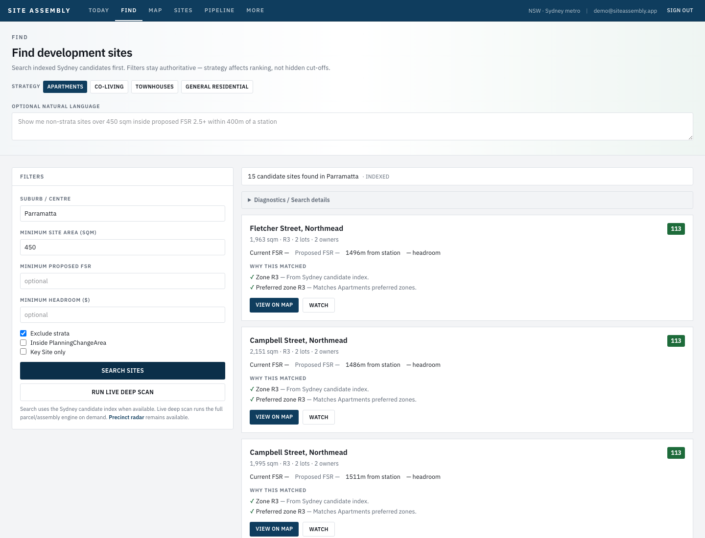

# Harry Find workflow fix #1

Draft PR evidence for usable index-first Find (Parramatta acceptance).

## Acceptance (indexed)

| Setting | Value |
|---------|-------|
| Strategy | Apartments |
| Suburb | Parramatta |
| Min site area | 450 sqm |
| Min proposed FSR | blank |
| Min headroom | blank |
| Exclude strata | checked |
| Natural language | blank (placeholder only) |

Expected: indexed results appear quickly; no hidden positive-headroom filter; diagnostics collapsed.

## Screenshot

## Index place scope (hardening)

`findFromIndex` applies suburb/LGA `WHERE` in the database **before** `orderBy`/`take`. It does not fetch a global top-N then filter place in memory. Address contain is an optional fallback only when suburb/LGA return zero rows.
